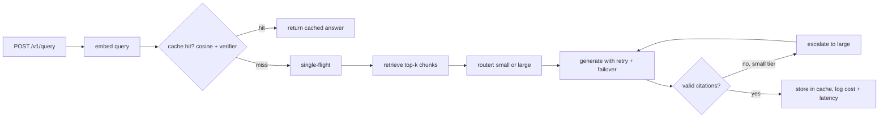

# ragcache: semantic caching and cost-aware routing for RAG

A RAG service that decides for each question whether it needs an LLM at all, and if it does, which size of model to use.

## What I did
- Built a **semantic cache** that stores answers by the embedding of the question, so differently worded questions can share an answer. A guard stops matches that differ in a number or a negation ("30 days" vs "60 days"). Re-ingesting a document automatically invalidates the answers that depended on it.
- Built a **router** that sends a cache miss to a small or large model using a score from query length, comparison words, weak retrieval and number of clauses. If the small model's answer has no valid citations, the request goes to the large model. If a provider fails, it moves to the next model.
- Logged tokens, cost (from a price table), latency split into retrieval and generation, cache result and route for every request, and built a `/dashboard` with hit rate, cost, cost saved by the cache and p50/p95/p99 latency.
- Added a **second-stage verifier**: a cross-encoder (`cross-encoder/quora-distilroberta-base`) reads the new question and the cached one together and only lets the hit through if it scores high enough. With the verifier on, cache candidates start at cosine 0.88 instead of 0.95. It is switched on with the runtime config `verifier_enabled` and evaluated with `ragcache eval-verifier`.
- Made identical questions that arrive at the same time share one LLM call.
- Measured the best cache threshold on 40,430 labelled question pairs from Quora Question Pairs.

## Results
Cache threshold on Quora Question Pairs (14,885 duplicates out of 40,430 pairs):

| Threshold | Precision, guard off | Precision, guard on | Recall, guard on |
|---:|---:|---:|---:|
| 0.88 | 0.722 | 0.734 | 0.637 |
| 0.92 | 0.801 | 0.813 | 0.452 |
| 0.94 | 0.844 | 0.853 | 0.341 |
| 0.96 | 0.885 | 0.891 | 0.228 |
| 0.98 | 0.929 | 0.933 | 0.117 |

- The number and negation guard cuts false hits by 7 to 12% at the same threshold.
- I set the default threshold to 0.95.

With the verifier (candidates at cosine 0.88 and up, number/negation guard on, same 40,430 pairs):

| Verifier min score | Precision | Recall | False hits served |
|---:|---:|---:|---:|
| 0.50 | 0.908 | 0.589 | 885 |
| 0.70 | 0.917 | 0.579 | 779 |
| 0.90 | 0.934 | 0.536 | 560 |
| 0.95 | 0.947 | 0.479 | 399 |
| 0.99 | 0.977 | 0.263 | 92 |

- At about the same precision as the best cosine-only setting (0.98: precision 0.933, recall 0.117), the verifier at 0.90 gets precision 0.934 with recall 0.536, so about 4.6 times more correct hits are served. Raw output: [docs/verifier_eval_raw.txt](docs/verifier_eval_raw.txt).
- In a live run with Ollama `llama3.2:3b` (15 queries), cache hits took about 7 ms against about 4.9 s for a generated answer. This run also found two bugs (the model writing `INSUFFICIENT CONTEXT` with a space, and answers that were only `[1]`), which I fixed.
- 63 automated tests pass.

## How it was built

Prices, thresholds, router weights and prompts are stored in the database, so they can change without redeploying.

## Tech stack
Python, FastAPI, Pydantic, SQLite, fastembed (bge-small embeddings), sentence-transformers cross-encoder, Anthropic and OpenAI-compatible clients, Ollama, pytest, Docker.

## Data
Quora Question Pairs (via GLUE).
