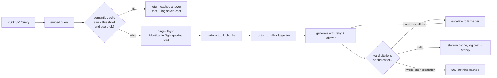

# ragcache: semantic caching and cost-aware routing for RAG

A RAG service that decides, per request, whether it needs an LLM at all and, if it does, which one.

1. **Semantic cache.** Answers are cached by query *embedding*, so "how long does shipping take" and "how many days for delivery" can share one answer. A guard stops near-misses that differ in a number or a negation ("refund within 30 days" vs "60 days"). Re-ingesting documents invalidates the affected answers automatically.
2. **Cost-aware routing.** Misses go to a **small** or **large** model tier chosen by an inspectable, configurable score (query length, comparison cues, weak retrieval, clause count). If a small model returns an answer without valid citations, the request **escalates** to the large tier. Provider failures fail over to the next model.
3. **Per-request accounting and a dashboard.** Every request records tokens, cost (from a price table you control), latency split into retrieval and generation, cache result, route and escalation. `/dashboard` shows hit rate, cost, **cost avoided by the cache**, and p50/p95/p99 latency by route.

> **Status: engineering-complete, not yet measured on production traffic.** The cache-threshold numbers below were measured on a public benchmark. The end-to-end *cost and p95-latency reduction on real traffic* is deliberately **not** claimed: it depends on your query distribution and model prices, and it needs an LLM key that was not available when this was built. The request log, replay-friendly API and dashboard exist so you can measure it on your own data.



## Quickstart

```bash
pip install -e ".[dev]"
cp .env.example .env            # then set RC_ADMIN_API_KEY to a long random value

# 1. register models (prices are USD per million tokens; keys are read from the named env variable)
ragcache models add small-m --provider anthropic --model-id <small-model-id> --tier small \
    --input-price <usd> --output-price <usd> --api-key-env ANTHROPIC_API_KEY
ragcache models add large-m --provider anthropic --model-id <large-model-id> --tier large \
    --input-price <usd> --output-price <usd> --api-key-env ANTHROPIC_API_KEY
# any OpenAI-compatible server (OpenAI, Ollama, vLLM, LM Studio) works too:
#   --provider openai_compat --base-url http://localhost:11434/v1

# 2. ingest documents (.txt / .md files or folders)
ragcache ingest kb ./docs

# 3. run
ragcache serve                  # http://127.0.0.1:8000, dashboard at /dashboard
```

```bash
curl -s localhost:8000/v1/query -H 'content-type: application/json' \
  -d '{"collection": "kb", "query": "How long does shipping take?"}'
```

Response shape (values are illustrative):

```json
{
  "answer": "Standard shipping takes 5 business days [1].",
  "abstained": false,
  "citations": [{"n": 1, "document": "docs/shipping.md", "title": "shipping"}],
  "cache": {"hit": false, "similarity": 0.61},
  "routing": {"tier": "small", "model": "small-m", "escalated": false, "reasons": ["simple, well-supported query"]},
  "usage": {"input_tokens": 912, "output_tokens": 41, "cost_usd": 0.0011, "saved_cost_usd": 0.0},
  "latency_ms": 1210.4
}
```

Ask the same question again and `cache.hit` is `true`, `cost_usd` is `0`, and `saved_cost_usd` is what the original call cost.

## Design decisions worth knowing

| Decision | Why |
|---|---|
| Cache key is the query embedding **plus** (collection, corpus version) | Re-ingesting a document bumps the version in the same transaction, so stale answers can never be served. |
| Numbers/negation **guard** on cache hits | Embedding models score "30 days" and "60 days" as near-identical. The guard removes a measurable share of false hits (see Evaluation). |
| Default threshold **0.95**, not 0.9 | Measured: at 0.92 only about 80% of served hits were genuine duplicates on Quora Question Pairs. |
| Deterministic router, not a learned one | A learned router needs outcome labels that do not exist until the system has run; a transparent rule is auditable and tunable at runtime. The escalation log is the data you would train one on. |
| Validation before caching | Abstentions and answers without valid citations are never cached, so one bad generation cannot be replayed to everyone. |
| Prices, thresholds, router weights and prompts live in the **database** | Tunable via `PUT /v1/admin/config` or `ragcache config set` with no redeploy. Secrets stay in environment variables. |
| Single-flight on misses | N identical concurrent queries cost one LLM call (tested with 6 threads). |
| SQLite + in-memory exact search | Zero infrastructure and correct. The cache and retriever sit behind small classes; swap in pgvector or Qdrant when the corpus or cache outgrows one machine. |

Full specification, failure matrix, threat model and decision records: [`docs/SPEC.md`](docs/SPEC.md).

## Configuration

| Where | What | Change requires |
|---|---|---|
| Environment (`RC_*`, see `.env.example`) | DB path, embedding model, admin and query API keys, LLM timeout/retries | restart |
| `models` table (`ragcache models …`, `/v1/admin/models`) | provider, model id, tier, base URL, **key env-var name**, prices, priority, active | nothing |
| `runtime_config` table (`ragcache config …`, `PUT /v1/admin/config`) | cache threshold, TTL, size and guard; top-k and chunking; router weights and threshold; multi-hop cue patterns; escalation; system prompt; query-text logging | nothing (applied within seconds) |

Runtime values are validated on write: a bad regex, an out-of-range threshold or a prompt missing its placeholder is rejected with 422 and nothing is persisted.

## API

| Method | Route | Auth | Purpose |
|---|---|---|---|
| POST | `/v1/query` | optional `RC_QUERY_API_KEY` | answer a question |
| POST | `/v1/collections/{name}/documents` | admin | idempotent upsert of a document |
| GET / PUT | `/v1/admin/config` | admin | read / change runtime config |
| GET / POST | `/v1/admin/models` | admin | list / upsert models |
| GET | `/v1/metrics/summary?window_seconds=` | admin | the numbers behind the dashboard |
| GET | `/dashboard` | page is public, data needs the admin key | cost and latency dashboard |
| GET | `/healthz`, `/readyz` | none | liveness, database readiness |

## Evaluation

### Cache threshold: measured on 40,430 labelled question pairs

`ragcache eval-threshold` embeds labelled duplicate and non-duplicate pairs with the real embedding model (`BAAI/bge-small-en-v1.5`) and reports, per threshold, what fraction of the *served* hits would have been correct. Data: the validation split of **Quora Question Pairs** (via GLUE), 14,885 duplicates out of 40,430 pairs (`scripts/download_qqp.py`). Raw output: [`docs/qqp_threshold_eval_raw.txt`](docs/qqp_threshold_eval_raw.txt).

| Threshold | Precision, guard off | Precision, guard on | Recall, guard on | False hits served, guard off → on |
|---:|---:|---:|---:|---:|
| 0.88 | 0.722 | 0.734 | 0.637 | 3,882 → 3,429 |
| 0.92 | 0.801 | 0.813 | 0.452 | 1,729 → 1,552 |
| 0.94 | 0.844 | 0.853 | 0.341 | 966 → 876 |
| 0.96 | 0.885 | 0.891 | 0.228 | 452 → 416 |
| 0.98 | 0.929 | 0.933 | 0.117 | 134 → 125 |

What this says:

- **Semantic caching with a small embedding model is a precision problem.** Even at 0.96, about 1 in 9 served hits is a false duplicate by QQP's labels. QQP labels are strict and somewhat noisy, and a wrong hit in a narrow support knowledge base is often milder than in QQP's open domain, but the direction is clear: do not run a low threshold.
- **The numbers/negation guard helps modestly**: 0.4 to 1.2 points of precision and 7 to 12% fewer false hits at the same threshold, because most QQP false duplicates differ in meaning rather than in digits.
- The default is therefore **0.95**. If you need more precision than the embedding alone gives, add a second-stage verifier (cross-encoder or a small-LLM judge) before serving a hit. That is on the roadmap and not implemented.

Run it on *your* queries before trusting any threshold, including this one: `ragcache eval-threshold your_pairs.jsonl --min-precision 0.98`.

### What is tested

47 automated tests (`pytest`):

- cache hit, miss, guard, expiry, eviction and persistence across restart;
- corpus-version invalidation;
- router decisions;
- miss-then-hit cost accounting against the price table;
- escalation cost (both calls are billed);
- abstentions and invalid answers never cached;
- provider retry and cross-tier failover;
- total failure returns 502 and logs an `error` row;
- concurrent single-flight;
- runtime-config validation;
- authentication on every admin route, metrics and the dashboard.

One test uses the real embedding model (`pytest -m embedding`). The fake LLM and a hashing embedder exist **only** under `tests/`.

### What is not verified

- **Live LLM calls.** The Anthropic and OpenAI-compatible clients follow the public API shapes and are exercised in tests only through the provider interface. They have not been run against a real endpoint here. Treat the first run as an integration test.
- **Cost and p95-latency savings on real traffic**, and **answer quality under routing.** Measuring quality needs labelled answers and an LLM judge or human review; the request log gives you everything else.

## Limitations and roadmap

- Exact (brute-force) in-memory vector search: fine up to roughly hundreds of thousands of vectors per process; use an ANN index beyond that.
- Single process, SQLite. Multiple replicas need a shared database (Postgres) and a shared cache index.
- The cache is shared by all callers of a collection. Do not put per-user-permissioned content in a cached collection (see the sibling project `permission-aware-rag`).
- Roadmap: second-stage hit verifier, a learned router trained from the escalation log, streaming responses.

## Development

```bash
pip install -e ".[dev]"
pytest -q                       # add -m "not embedding" to skip the model download
ruff check src tests && ruff format --check src tests
mypy src
pip install pyarrow && python scripts/download_qqp.py && ragcache eval-threshold data/qqp_validation.jsonl
```

A `Dockerfile` is included (single container, non-root, SQLite on a `/data` volume). It was not built or run in the environment this project was developed in, so treat it as untested until your CI builds it.

## License

MIT
